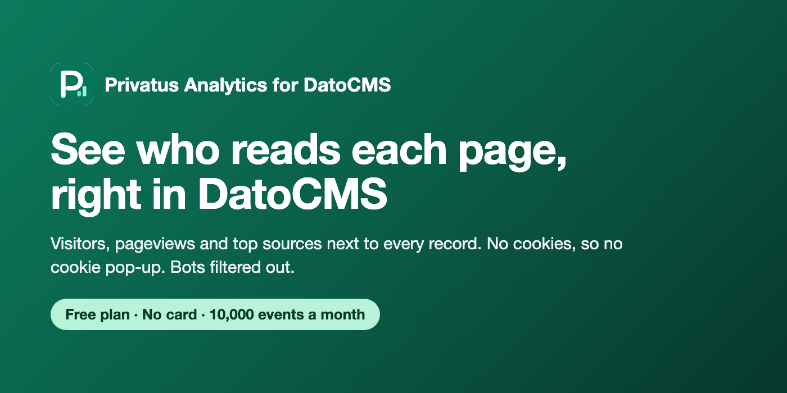

# Privatus Analytics for DatoCMS

Cookie pop-ups make visitors leave. Bots make your numbers look bigger than they are. And your stats live far away from the content you write.

This DatoCMS plugin fixes that. It shows how many real people read each record, right in the record's sidebar. [Privatus Analytics](https://privatusanalytics.com) counts visitors without cookies, so your website does not need a cookie pop-up, and it filters out bots.



## What you get

- **A sidebar panel on each record.** Visitors, pageviews, bounce rate and visit time for that record's page, compared with the period before. You also see where readers came from (search, social, email and so on).
- **An Analytics tab** in the top menu of DatoCMS. Numbers for your whole website and your top pages.
- **The tracker tag** to paste into your website, filled in with your site ID.

The free plan of Privatus Analytics includes 10,000 events a month and 3 sites. No card needed.

## Set it up

1. [Make a free Privatus Analytics account](https://privatusanalytics.com) and add your website. Copy the site ID. It looks like `pa_ABC123`.
2. Add the tracker tag to the `<head>` of the website that shows your DatoCMS content:

   ```html
   <script defer src="https://privatusstats.com/js/pa.js" data-site="pa_YOURSITEID" data-modules="engage,auto,vitals,clicks,ask"></script>
   ```

3. In Privatus Analytics, make an API token with **read-only** access (Account, API tokens). It starts with `pat_`.
4. In DatoCMS, open **Configuration**, then **Plugins**, and add **Privatus Analytics** from the marketplace.
5. Paste your site ID and API token in the plugin settings and pick a date range. Press **Check connection** to make sure it works.
6. For each model, write where its records live on your website. Put a field's API key in curly brackets:

   | Model | Page path |
   | --- | --- |
   | Blog post | `/blog/{slug}` |
   | Docs page | `/{locale}/docs/{slug}` |
   | Home page (single record) | `/` |

   `{locale}` becomes the language you are editing. Localized fields use the value for that language. Leave a model empty to hide the panel on it.

## Good to know

- **Use a read-only token.** Plugin settings can be read by everyone in your DatoCMS project who can use plugins. A read-only token can only read numbers, never change anything.
- **Numbers come from your website, not DatoCMS.** The panel shows nothing until the tracker tag is on your website and people visit the page.
- **Custom events** come from the browser with `window.privatus.track(name, props)`. See the [docs](https://privatusanalytics.com/docs).
- The plugin talks only to `privatusanalytics.com`, straight from your browser. It has no server of its own.

## Develop

```bash
npm install
npm test        # unit and component tests
npm run build   # builds dist/index.html
npm run dev     # serves the plugin at http://localhost:5173 for a private DatoCMS plugin
```

To try changes in DatoCMS, add a private plugin with the URL `http://localhost:5173`.

## Links

- [Privatus Analytics](https://privatusanalytics.com)
- [API docs](https://privatusanalytics.com/docs/api)
- [MCP server](https://github.com/Privatus-Analytics/mcp-server)

## License

MIT, Two Phase LLC. See [LICENSE](LICENSE).
